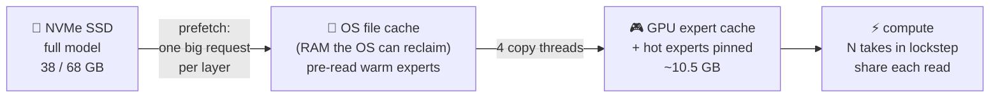
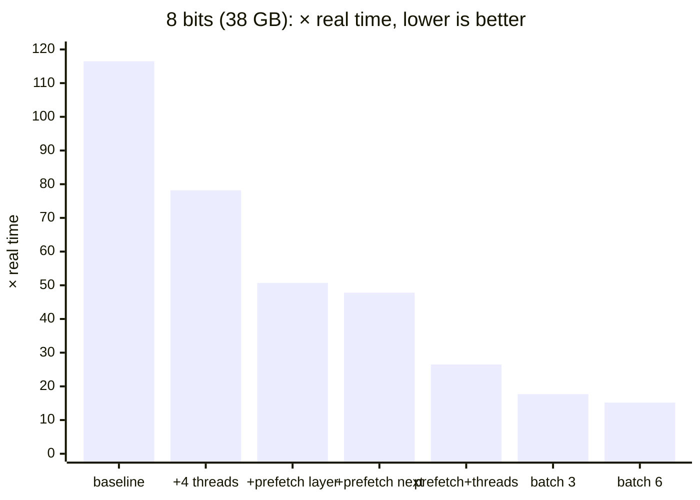

<div align="center">

# moe-offload-desktop

**Run a mixture-of-experts model that is bigger than your VRAM *and* your free RAM,<br>
on an ordinary desktop, without freezing the rest of the PC.**

[](LICENSE)
[](https://github.com/0xShug0/audio.cpp)
[](https://huggingface.co/fishaudio/drama-3)
[](#test-machine)
[](#techniques)
[](#licenses-and-credits)

[](#results)
[](#results)
[](#results)
[](#did-the-pc-freeze)

[Results](#results) · [Techniques](#techniques) · [Reproduce](#how-to-reproduce) · [Full method](METHOD.md) · [Português](README.pt-BR.md)

</div>

---

## At a glance

A **68 GB** (16-bit) and a **38 GB** (8-bit) text-to-speech MoE, running on a **16 GB** graphics card while the
computer stays in normal use.

| | Before | After | Gain |
|---|:---:|:---:|:---:|
| **8 bits** (38 GB) · one 6.2 s line, wall time | 12 min 05 s | **2 min 25 s** | **5.0× faster**¹ |
| **16 bits** (68 GB) · one 5.8 s line, wall time | 17 min 18 s | **5 min 02 s** | **3.4× faster** |
| **8 bits**, 6 takes at once | 116.5× real time | **15.2× real time** | **7.7× faster** |
| Worst system lag while generating | — | **7 ms** max, 0 over 50 ms | PC stays usable |

<sub>¹ Final build, single take (23.2× real time). In the step-by-step series below the same configuration
measured 26.5× real time (4.4×). One run each, so the gap mixes the final build and run-to-run variation.</sub>

> [!NOTE]
> Every number comes from a logged run (one JSON line per run), with a cold OS file cache. One machine, one
> model, one run per configuration: read the [limits](#limits) before comparing small differences.

## Contents

- [The problem](#the-problem)
- [The idea in one sentence](#the-idea-in-one-sentence)
- [Techniques](#techniques)
- [Results](#results)
- [How to reproduce](#how-to-reproduce)
- [Limits](#limits)
- [Licenses and credits](#licenses-and-credits)

## The problem

Measured case: Fish Audio **Drama 3**, a ~35B-parameter MoE text-to-speech model
(3B active per token, 40 layers × 256 experts, 8 experts per token).

<a id="test-machine"></a>

| Test machine | |
|---|---|
| 🎮 GPU | RTX 5060 Ti, 16 GB (the model is held to ~10.5 GB, so ≥3 GB stay free for the desktop and other apps) |
| 🧠 RAM | 31 GB, with WSL/Docker and everyday apps open (5–15 GB actually free) |
| 💾 Disk | one NVMe SSD |
| 🪟 OS | Windows 11, no administrator rights needed |

Neither file fits in 16 GB of VRAM, and they do not fit in the free RAM either.
The runtime ([audio.cpp](https://github.com/0xShug0/audio.cpp), a ggml/GGUF engine) can already keep the
experts on disk and stream them into a small GPU cache. Out of the box that works, but slowly:
**116× real time** at 8 bits (12 minutes for a 6-second line) and **180×** at 16 bits.
The SSD was delivering ~150 MB/s because each missing expert was read through one page fault at a time.

## The idea in one sentence

> With experts on disk, the bottleneck is **reading experts**, not math.

Every technique below attacks one part of the reading: read *ahead of time* (prefetch), read *fewer times*
(batching), read from the *fastest tier* (hot map), while the process runs politely so the rest of the PC
does not notice.



## Techniques

| # | Technique | Measured gain | What it does |
|:-:|---|:---:|---|
| 1 | **Prefetch** | **~4.4×** | Ask the OS for all missing experts of a layer in one call, and for the next layer in the background |
| 2 | **Batching** | **1.56×** (3 takes) · **1.82×** (6) | N sequences share every expert read; their state stays in VRAM |
| 3 | **Hot-expert map** | +4% | Pin the most used experts in VRAM, pre-read the next ones into RAM |
| 4 | **Polite process** | costs ~4% | Low priorities and hard memory caps, so the desktop stays responsive |
| 5 | Lossless compression (DFloat11-style) | not applicable | No decompression kernel in ggml; the checkpoint is already FP8 |

<details>
<summary><b>1. Prefetch: details</b> (biggest win)</summary>

- *Within the layer:* before copying the missing experts out of the `mmap`, ask the OS for all of them in one
  call (`PrefetchVirtualMemory` on Windows, `madvise(MADV_WILLNEED)` on Linux). The SSD gets a deep queue of
  large reads instead of serial page faults.
- *Next layer:* while layer L computes, a background thread prefetches the experts layer L+1 used on the
  previous step (routing changes little from step to step). Stale predictions are dropped, not queued.
- Combined with 4 parallel copy threads, disk throughput went from 144 MB/s to ~530 MB/s.

</details>

<details>
<summary><b>2. Batching: details</b></summary>

Inspired by FlexGen (Sheng et al., 2023): N sequences advance in lockstep, so each layer loads the *union* of
the experts they need and every expert read serves all of them. Per-sequence state (KV cache, recurrent state,
audio-tower cache, ~155 MB each) stays **in VRAM**; the first version swapped it through RAM and lost almost all
of the gain.

</details>

<details>
<summary><b>3. Hot-expert map: details</b></summary>

Record how often each (layer, expert) is requested on representative input, pin the most used ones in VRAM,
pre-read the next ones into the OS file cache (RAM that the OS can drop when another app needs it), stream the
rest from SSD. `scripts/hot_map.py` prints the coverage of each tier, which is the ceiling of the gain. This
model's router spreads requests evenly, so the gain was small.

</details>

<details>
<summary><b>4. Polite process: details</b></summary>

Below-normal CPU priority, low I/O and memory priority, a hard 4 GB working-set cap
(`SetProcessWorkingSetSizeEx`, no admin needed) and a commit cap via a Job Object. Few CPU threads, because the
bottleneck is I/O.

</details>

<details>
<summary><b>5. Why not lossless compression</b></summary>

DFloat11-style compression needs a decompression kernel the ggml runtime does not have, and the official
checkpoint is FP8 with block scales, so "16 bits" carries no more information than FP8 anyway.

</details>

📘 The full method, written to be reused for any MoE in GGUF, is in **[METHOD.md](METHOD.md)**.

## Results

Cold OS file cache before every run (14 GB of another file read first). `× real time` = wall time
(including ~20 s of model load) ÷ seconds of audio produced. Short Portuguese line, one seed per config.
**Lower is better.**



### 8 bits (Q8_0, 38 GB), GPU cache of 32 experts per layer

| Configuration (cumulative) | × real time | speed-up | VRAM peak | disk avg |
|---|--:|--:|--:|--:|
| baseline: serial page faults on the mmap | 116.5 | 1.0× | 9.4 GB | 144 MB/s |
| + 4 read threads (built-in option) | 78.2 | 1.49× | 9.4 GB | 191 MB/s |
| + prefetch within the layer | 50.7 | 2.30× | 9.4 GB | 296 MB/s |
| + prefetch of the next layer | 47.8 | 2.44× | 9.3 GB | 315 MB/s |
| prefetch (both) + 4 read threads | **26.5** | **4.40×** | 9.4 GB | 534 MB/s |
| same + 4 GB RAM cap (cost of politeness) | 27.6 | 4.22× | 9.4 GB | 565 MB/s |
| + hot map (16 pinned in VRAM + 22 pre-read to RAM per layer) | 26.5 | 4.40× | 9.4 GB | 553 MB/s |
| batch of 3 takes | **17.7** | **6.58×** | 9.9 GB | 573 MB/s |
| batch of 6 takes | **15.2** | **7.66×** | 10.3 GB | 561 MB/s |

⏱️ Wall time for one 6.2 s line: **12 min 05 s → 2 min 25 s** (final build, single take).

### 16 bits (F16, 68 GB), GPU cache of 12 experts per layer (to fit ~10.5 GB)

| Configuration | × real time | speed-up | VRAM peak | disk avg |
|---|--:|--:|--:|--:|
| baseline (serial, no prefetch) | 180.3 | 1.0× | 10.4 GB | 210 MB/s |
| prefetch + 4 read threads + 4 GB RAM cap | **52.4** | **3.44×** | 10.3 GB | 688 MB/s |
| same, batch of 3 (cache 10) | **43.2** | **4.17×** | 10.4 GB | 632 MB/s |

⏱️ Wall time for one 5.8 s line: **17 min 18 s → 5 min 02 s**.

### Did the PC freeze?

**No.** A *separate* process at normal priority measured how late a `sleep(10 ms)` woke up, every 10 ms:

| | p50 | p99 | max | delays > 50 ms |
|---|--:|--:|--:|--:|
| before generating | 0.43 ms | 0.65 ms | 0.9 ms | 0 |
| during every measured run | — | 0.67–0.69 ms | 1.3–7 ms | **0** |

CPU use of the generator: 2–17%. With the 4 GB cap, available RAM never went below 2.5 GB.

### Audio quality

All 8- and 16-bit outputs were transcribed correctly by Whisper large-v3 and stayed inside the human range on
the acoustic metrics we use. With one take per precision, the difference between 8 and 16 bits was the same
size as the difference between two takes of the same precision, so we make **no claim** that one sounds better.
What changes consistently is cost: 16 bits reads 2.4× more expert bytes per second of audio.

## How to reproduce

> [!IMPORTANT]
> You need an NVIDIA GPU with CUDA, an NVMe SSD with room for the model, Python 3.10+ with `psutil` and
> `soundfile` (for the measuring script), and the build tools audio.cpp asks for.

**1. Get the runtime and apply the patch.**

```sh
git clone --branch v0.9.6 https://github.com/0xShug0/audio.cpp
cd audio.cpp
git apply ../moe-offload-desktop/patches/audio.cpp-v0.9.6-moe-offload.patch
```

Then build it with CUDA following audio.cpp's own instructions.

**2. Get the model from the official source**: [fishaudio/drama-3 on Hugging Face](https://huggingface.co/fishaudio/drama-3).
Accept its license there. This repository does **not** contain or redistribute any weights.

**3. Convert and quantize** with audio.cpp's official converter (`audiocpp_gguf`).

> [!WARNING]
> Keep routers in their original precision and quantize the experts explicitly: in v0.9.6, 3D expert banks and
> the embedding do **not** follow `--type`. Pass
> `--keep-type "model_weights/model.language_model.layers.<L>.mlp.experts.*=q8_0"` for each layer (and for
> `embed_tokens`), and check the per-tensor types and the final size before measuring.

**4. Run with the method enabled.** The patch is controlled by environment variables:

| Variable / option | Effect |
|---|---|
| `AUDIOCPP_MOE_PREFETCH=0/1/2` | 1: prefetch within the layer; 2: also the next layer in the background |
| `AUDIOCPP_MOE_STATS=<csv>` | write `group;expert;requests;misses` on exit (input for the hot map) |
| `AUDIOCPP_MOE_HOTMAP=<csv>` | lines `layer;expert;vram\|ram` |
| `AUDIOCPP_MOE_WARM_MB=<n>` | budget for pre-reading the RAM tier |
| request option `batch_takes=N` (fish_drama3) | N takes (seeds s..s+N-1) in lockstep |
| session options `moe_disk_experts=true`, `moe_expert_cache_size=N`, `moe_disk_expert_read_threads=4` | built into audio.cpp |

**5. Measure like we did (Windows).** `scripts/run_measured.py` launches the CLI with low priorities and the
memory caps, and records wall time, VRAM, RAM, disk and the lag probe as one JSON line per run in
`<out>/medidas.jsonl` (the script's flags and output keys are in Portuguese; see `--help`).
`scripts/run_series.ps1` runs several configurations in a row with a cold cache:

```powershell
pwsh -File scripts/run_series.ps1 -Python python -Cli <path>\audiocpp_cli.exe -Model drama3-q8.gguf `
  -Out results -Ref voice.wav -Text "Your test sentence." -ColdFile <any file of 14+ GB> `
  -Config "baseline|--cache 32;fast|--cache 32 --prefetch 2 --read-threads 4 --teto-ram-gb 4;batch3|--cache 32 --prefetch 2 --read-threads 4 --teto-ram-gb 4 --takes 3"
```

The reference voice needs a `voice.txt` next to it containing `anything;<transcript of voice.wav>`.

**6. Hot map:** run once with `--stats usage.csv`, then

```sh
python scripts/hot_map.py usage.csv hotmap.csv 16 22
```

and run again with `--hotmap hotmap.csv --warm-mb 3072`.

## Limits

- One machine, one model, one short sentence; **one run per configuration**. Differences below ~5% are noise.
- Numbers are with a cold file cache. Consecutive generations are faster.
- Batching here means several takes of the *same* sentence (shared prompt). Different sentences in one batch
  would need a separate prompt prefill per sentence; not implemented.
- The hot map was recorded on the test sentence itself; a production map should come from many sentences.
- The measuring scripts are Windows-only (Job Objects, `SetProcessWorkingSetSizeEx`). The prefetch in the patch
  has a Linux path (`madvise`), but it was only measured on Windows.
- Still slow in absolute terms (2.5 minutes for 6 seconds of speech at 8 bits). The point is that a model this
  size runs at all on a 16 GB card while you keep using the computer.

## Licenses and credits

- Code and docs in this repository: [Apache-2.0](LICENSE).
- The patch modifies [audio.cpp](https://github.com/0xShug0/audio.cpp) v0.9.6, © 2026 ShugoAI LLC,
  Apache-2.0. See [NOTICE](NOTICE).
- **Built with Fish Audio.** Drama 3 is under the
  [Fish Audio Community License v1.0](https://huggingface.co/fishaudio/drama-3/blob/main/LICENSE).
  No weights or generated audio are distributed here; download the model from the official source and follow its
  license (among other terms: revenue limit for commercial use, no TTS-as-a-service, no imitating a real person's
  voice without consent, no training other voice models on its outputs).
- Batching idea: Y. Sheng et al., *FlexGen: High-Throughput Generative Inference of Large Language Models with
  a Single GPU*, ICML 2023.
