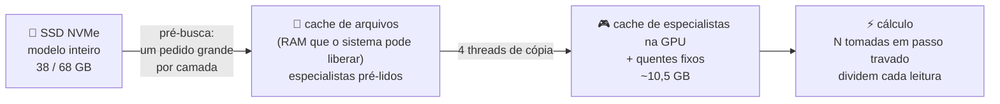

# moe-offload-desktop

**Rodar um modelo *mixture of experts* maior que a VRAM *e* que a RAM livre num PC comum, 
sem travar o resto do computador.**

[English (texto completo)](README.md) · [Método](METHOD.md) · [Patch](patches/) · [Scripts](scripts/)

---

## Em resumo

Um TTS MoE de **68 GB** (16 bits) e **38 GB** (8 bits) rodando numa placa de **16 GB**, com o computador em uso
normal durante a geração.

| | Antes | Depois | Ganho |
|---|:---:|:---:|:---:|
| **8 bits** (38 GB) · fala de 6,2 s, tempo de parede | 12 min 05 s | **2 min 25 s** | **5,0× mais rápido**¹ |
| **16 bits** (68 GB) · fala de 5,8 s, tempo de parede | 17 min 18 s | **5 min 02 s** | **3,4× mais rápido** |
| **8 bits**, 6 tomadas de uma vez | 116,5× o tempo real | **15,2× o tempo real** | **7,7× mais rápido** |
| Pior atraso do sistema durante a geração | — | **7 ms** no máximo, nenhum acima de 50 ms | PC continua usável |

¹ Build final, uma tomada (23,2× o tempo real). Na série passo a passo a mesma configuração mediu 26,5× o
tempo real (4,4×). Uma medida de cada, então a diferença mistura o build final e a variação entre rodadas.

> [!NOTE]
> Todo número vem de uma rodada registrada (uma linha JSON por rodada), com o cache de arquivos do sistema frio.
> Uma máquina, um modelo, uma medida por configuração: veja os [limites](#limites).

## O problema

Caso medido: **Drama 3** da Fish Audio, um TTS MoE de ~35B parâmetros (3B ativos por token, 40 camadas × 256
especialistas, 8 por token).

| Máquina de teste | |
|---|---|
| 🎮 GPU | RTX 5060 Ti de 16 GB (o modelo fica limitado a ~10,5 GB, sobrando ≥3 GB para o resto) |
| 🧠 RAM | 31 GB, com WSL/Docker e apps abertos (5–15 GB livres de fato) |
| 💾 Disco | um SSD NVMe |
| 🪟 Sistema | Windows 11, sem administrador |

Nenhum dos dois arquivos cabe na VRAM nem na RAM livre. O [audio.cpp](https://github.com/0xShug0/audio.cpp) já
consegue deixar os especialistas no disco e trazê-los para um cache pequeno na GPU, mas devagar: **116× o tempo
real** em 8 bits (12 minutos para uma fala de 6 segundos) e **180×** em 16 bits. O SSD entregava ~150 MB/s,
porque cada especialista era lido por uma falha de página de cada vez.

> Com os especialistas no disco, o gargalo é **ler especialistas**, não fazer conta.

## O que funcionou

| # | Técnica | Ganho medido | O que faz |
|:-:|---|:---:|---|
| 1 | **Pré-busca** | **4,4×** em 8 bits · **3,4×** em 16 bits | Pede ao sistema todos os especialistas da camada de uma vez e lê a próxima camada em segundo plano; com 4 threads de cópia, o disco foi de 144 para 534 MB/s |
| 2 | **Lote** | **1,56×** (3 tomadas) · **1,82×** (6) | Várias tomadas em passo travado dividem cada leitura; o estado de cada uma fica na VRAM. 8 bits chega a 15,2× o tempo real |
| 3 | **Mapa de especialistas quentes** | +4% | Fixa os mais usados na VRAM e pré-lê os seguintes na RAM (o roteador deste modelo espalha os pedidos) |
| 4 | **Processo educado** | custa ~4% | Prioridades baixas e teto de 4 GB de RAM; atraso p99 de 0,7 ms, máximo 7 ms, nenhum acima de 50 ms |
| 5 | Compressão sem perda tipo DFloat11 | não se aplica | Sem kernel no ggml; o original já é FP8 |

Qualidade: 8 e 16 bits foram transcritos certo pelo Whisper large-v3; com uma tomada por precisão, não dá para
afirmar que um soa melhor que o outro.

📘 Tabelas completas e o passo a passo para reproduzir estão no [README em inglês](README.md); o método genérico,
para qualquer MoE em GGUF, no [METHOD.md](METHOD.md).

## Limites

- Uma máquina, um modelo, uma frase curta, **uma medida por configuração** (diferença abaixo de ~5% é ruído).
- Cache de arquivos frio; gerações seguidas são mais rápidas.
- Lote só para tomadas da mesma frase.
- Scripts de medição só no Windows.
- Continua lento em termos absolutos: a graça é rodar um modelo deste tamanho numa placa de 16 GB sem largar o
  computador.

## Licenças

- Código e textos: [Apache-2.0](LICENSE). O patch modifica o audio.cpp v0.9.6 (© 2026 ShugoAI LLC, Apache-2.0).
- **Built with Fish Audio**: o Drama 3 segue a
  [Fish Audio Community License v1.0](https://huggingface.co/fishaudio/drama-3/blob/main/LICENSE).
- Este repositório não tem nem redistribui pesos ou áudios gerados; baixe o modelo da fonte oficial e siga a
  licença.
